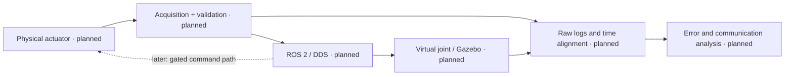

# Physical AI Digital Twin Lab

Open-source experimental laboratory for robotics, Digital Twins, distributed communication, simulation and Physical AI.

**Status: documented architecture; implementation planned.** This repository currently contains planning and experiment specifications. It has no running ROS 2 package, Gazebo actuator, physical connection, benchmark results or learned controller.

The first experiment will compare one actuator's physical and virtual joint state. Begin with a virtual actuator on ROS 2 Jazzy + Gazebo Harmonic, then introduce the existing LX-225/BusLinker driver through an explicit interface.

A one-way physical-state mirror is a digital shadow under this lab's working taxonomy. A Digital Twin claim requires an identified physical asset, explicit synchronization and a validated bidirectional interaction within a stated scope.

## Start here

- [Architecture and boundaries](docs/architecture/overview.md)
- [Roadmap v0.1–v1.0](ROADMAP.md)
- [Single-actuator experiment](docs/experiments/single-actuator.md)
- [Proposed state contract](docs/digital-twin/state-contract.md)
- [Communication measurement methodology](docs/communication/methodology.md)
- [Open-source projects and contribution targets](docs/open-source-projects.md)
- [References and limits](docs/references.md)
- [Initial issue drafts](docs/initial-issues.md)
- [Publication instructions](docs/publishing.md)

## Existing components, separate ownership

[GAIA simulation](https://github.com/Pedronsjaja/gaia-humanoid-simulation) provides an OP3 reference lab;
[LX-225 bench](https://github.com/Pedronsjaja/gaia-lx225-buslinker) provides Python serial tooling;
[GAIA structure](https://github.com/Pedronsjaja/gaia-humanoid-structure) provides CAD and model-data guidance;
[ROS environment](https://github.com/Pedronsjaja/gaia-ros2-ubuntu24) documents the development baseline.

These repositories remain separate. Team contributions and upstream authorship are not transferred to this laboratory. Do not import third-party CAD until its license is established.

## Evidence policy

Use REAL, SIMULATED, CALCULATED and ESTIMATED per channel. Missing data is UNKNOWN or NOT_MEASURED, never a plausible invented number.
Separate software tests, simulator tests and hardware tests. No hardware availability is assumed.

Physical AI, Isaac Sim/Lab, OpenUSD, Jetson, OPC UA, MQTT and CAD/CAE automation are future evaluation paths, admitted only by a reproducible experiment. No installation is required to review this repository.
